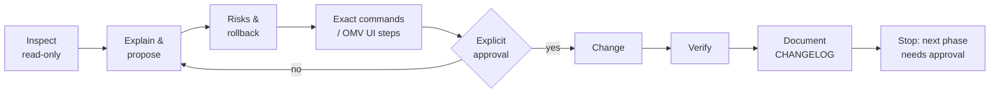
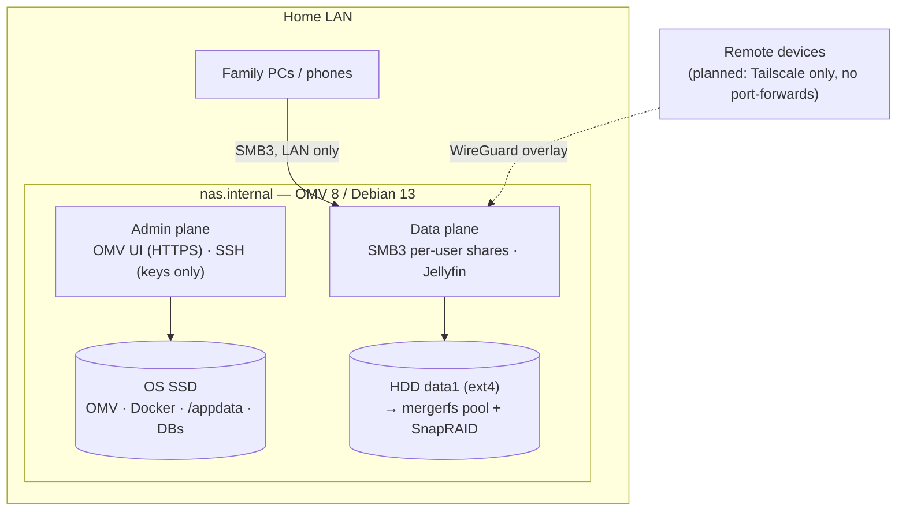

# homelab-nas-omv

Phase-gated design, hardening and operation of a real home NAS / private cloud on
**OpenMediaVault 8 (Debian 13)**, documented as configuration-as-code.

> **Sanitized portfolio copy.** This repository mirrors the documentation of a real,
> running server. Every personal identifier was replaced with fake example data:
> user names (`alex`, `sam`), disk serials, filesystem UUIDs, SSH key fingerprints,
> LAN/ISP addresses and time zone. Hardware models and the engineering content are real.

## The problem

A home server that will hold a family's irreplaceable data (photos, documents, university
and work files) is usually set up ad hoc: one wrong `mkfs`, `chmod -R` or open port is enough
to lose data or expose it. The goal here was the opposite: **anyone (including future me)
must be able to understand, operate and rebuild the NAS from this repository alone**, and
no destructive change may happen without a verified target, a rollback plan and a record.

## How it works

Every change follows the same loop, one phase at a time:



Disks are always identified by **model + serial + UUID**, never by `/dev/sdX` (on this
hardware the OS disk is `sdb`, not `sda`). Data is organized by value, and the top-level
folder decides the protection level:

| Tier | Examples | Protection |
|---|---|---|
| 1 – Irreplaceable | photos, documents, source code | parity + local + off-site versioned backup (3-2-1) |
| 2 – Important | OMV config, Compose files, app DBs | scheduled dumps, off-site, tested restore |
| 3 – Replaceable | movies, TV, music | parity only |

Target architecture (see [docs/architecture.md](docs/architecture.md)):



## What has been done (real server)

| Phase | Result |
|---|---|
| 0 Discovery | Read-only inventory script, hardware/disk/SMART baseline, numbered findings |
| 1 Hardening | Static IP, updates, named admin with ed25519 key, SSH root/password login off, X11 forwarding off, HTTPS-only UI, session timeout, email alerts, CGNAT exposure analysis |
| 2 Disk health | SMART on both disks, scheduled short/long self-tests, temperature thresholds, alert e-mail tested |
| 3 Data disk | 2 TB enterprise HDD verified by serial, formatted ext4 `data1` (1 % reserve) through the OMV UI |
| 4 Folders | Flat shared-folder layout per data tier, no world-writable paths |
| 5 Permissions | Data accounts without shell, `family` group, per-folder owner/mode/default ACLs, cross-user access test |
| 6 SMB | SMB3-only, no guest, NetBIOS off, access-based enumeration, per-user shares tested from each client |
| 7 Docker | Docker + Compose via the OMV compose plugin, app state on the SSD, stack conventions, smoke test |
| 8 Jellyfin | Non-root service UID, all capabilities dropped, media mounted read-only, iGPU render node only, LAN-IP bind |

Next phases (Immich, Tailscale remote access, monitoring, 3-2-1 backups, mergerfs/SnapRAID)
are planned in [docs/roadmap.md](docs/roadmap.md). Each architectural choice is recorded with
alternatives and rationale in [docs/decisions.md](docs/decisions.md) (D-01…D-18), and the
threat model (T1–T14) is in [docs/security.md](docs/security.md).

## Repository layout

```
├── CHANGELOG.md              every infrastructure change (objective, previous state, change, rollback, verification)
├── docs/
│   ├── architecture.md       design principles, data tiers, logical architecture
│   ├── roadmap.md            15 phases with exit criteria and detailed per-phase plans
│   ├── decisions.md          architectural decision records D-01…D-18
│   ├── security.md           threat model T1–T14 and controls mapped to threats
│   ├── storage.md            one ext4 per disk + mergerfs + SnapRAID (why not RAID)
│   ├── users-and-permissions.md, network.md, hardware.md, backups.md, disaster-recovery.md
│   ├── phase-0-discovery.md  inventory results and findings
│   ├── FORMACION_PROFESIONAL.md  skills demonstrated, with evidence (Spanish)
│   └── templates/change-record.md
├── compose/jellyfin/         hardened Compose stack + .env.example
├── scripts/discovery-readonly.sh   strictly read-only inventory script
└── specs/001-phase0-discovery/     spec-driven plan for Phase 0 (spec, plan, tasks, contracts)
```

## How to use it

Run the read-only inventory against your own OMV/Debian host (output stays local and is
git-ignored because it contains serials, MACs and IPs):

```bash
mkdir -p discovery-raw
ssh <admin>@<nas-host> 'sudo bash -s' < scripts/discovery-readonly.sh > discovery-raw/discovery-$(date +%F).txt 2>&1
```

Deploy the Jellyfin stack: copy [compose/jellyfin/compose.yaml](compose/jellyfin/compose.yaml)
into OMV → Services → Compose, create its `.env` from `.env.example`, and adapt the LAN IP,
service UID and media path (see [compose/README.md](compose/README.md)).

## Technologies

OpenMediaVault 8 · Debian 13 · Linux administration (systemd, SSH, sudo) · ext4 · POSIX ACLs ·
Samba / SMB3 · SMART (smartmontools) · Docker & Docker Compose · Jellyfin · Intel Quick Sync
(VA-API) · Bash · Git · Markdown · Spec Kit (spec-driven planning) · planned: Tailscale,
mergerfs, SnapRAID, Immich, off-site versioned backups.

## Author

**Sofia Rodriguez** ([@Sofiro11](https://github.com/Sofiro11)) did the design, the
implementation on the real server and the documentation. It is a personal project.

---

### Resumen en español

Documentación y configuración como código de un NAS doméstico real con OpenMediaVault 8.
El servidor se construyó por fases, y cada fase debía verificarse antes de empezar la siguiente:
inventario de solo lectura, refuerzo de seguridad, salud de discos, formateo controlado,
permisos por persona con ACLs, SMB3 en la LAN y Docker con contenedores sin privilegios
(Jellyfin). Todos los datos personales de esta copia son ficticios.
